# Tokyo Grid Lab — 東京エリア 電力需要予測 × 発電計画最適化


公開データだけを使って、

1. **LightGBM** で東京エリアの電力需要（1 時間値）を前日に予測し、**MAPE（平均絶対誤差率）** で評価する
2. **PuLP + HiGHS（無償ソルバー）** で、予測した需要を最小コストで満たす 24 時間の発電計画（火力の起動停止＋出力配分）を求める

までを一気通貫で行い、結果を Windows デスクトップアプリ **`TokyoGridLab.exe`** で可視化したポートフォリオ作品です。

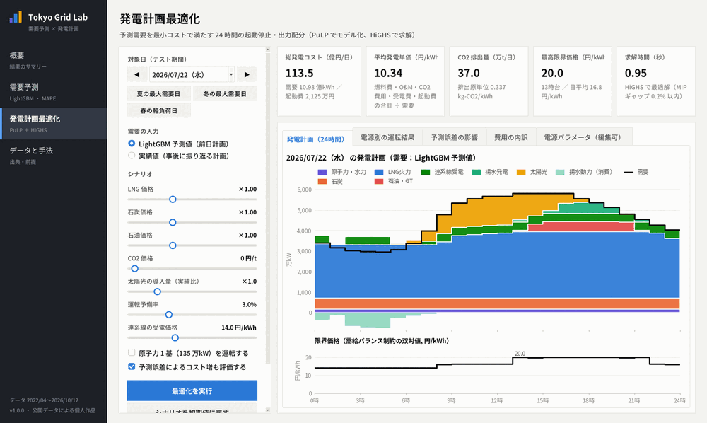

*夏の最大需要日 → 冬の最大需要日 → 春の軽負荷日 → 太陽光 2.5 倍シナリオ と切り替えて、その場で最適化し直している様子*

---

## 目次

- [ダウンロードと起動](#ダウンロードと起動)
- [主な結果](#主な結果)
- [画面の説明](#画面の説明)
  - [1. 概要](#1-概要)
  - [2. 需要予測](#2-需要予測)
  - [3. 発電計画最適化](#3-発電計画最適化)
  - [4. データと手法](#4-データと手法)
- [データ](#データ)
- [手法](#手法)
- [フォルダ構成](#フォルダ構成)
- [開発環境での実行・再現](#開発環境での実行再現)
- [注意事項](#注意事項)

---

## ダウンロードと起動

1. [Releases](https://github.com/kaseee/tokyo-grid-lab/releases/latest) から **`TokyoGridLab.exe`**（約 60 MB、Windows 10/11 64bit）をダウンロード
2. ダブルクリックで起動（インストール不要・Python 不要）
3. 初回は exe の展開に数十秒かかることがあります（起動中はスプラッシュ画面が出ます）

> Windows の SmartScreen で「Windows によって PC が保護されました」と表示された場合は、「詳細情報」→「実行」を選んでください（コード署名のない個人作成の exe のため）。

## 主な結果

| 項目 | 結果 |
|---|---|
| テスト期間 | 2025-10-01 〜 2026-10-12（9,048 時間。学習には一切使っていない直近約 1 年） |
| **LightGBM の MAPE** | **1.96%**（日最大需要の MAPE 2.15%、MAE 62 万kW、R² 0.982） |
| 比較：前週同時刻の値をそのまま使う方法 | MAPE 7.99% → LightGBM で誤差を約 75% 削減 |
| 特徴量グループ別のテスト MAPE | カレンダーのみ 7.21% → ＋需要ラグ 5.23% → ＋気象 2.30% → 全部 **1.96%** |
| 発電計画（例：2026/7/22 夏の最大需要日） | 火力 23 ユニット＋揚水の 24 時間 MILP を HiGHS で約 1 秒で求解。総コスト 113.5 億円/日、最高限界価格 20.0 円/kWh |
| 予測誤差の経済価値（同日） | 予測誤差（この日の MAPE 2.39%）による追加費用は 356 万円/日（完全予見比 +0.03%） |

参考：でんき予報の「予測値」（当日中に随時更新される予測）の MAPE は 1.07% です。前日予測とは使える情報が異なるため、比較ではなく参考として表示しています。

---

## 画面の説明

アプリは左のサイドバーで 4 つの画面を切り替えます。すべてのグラフは**マウスを重ねるとその時点の値がツールチップで表示**されます。ウィンドウは画面サイズと Windows の表示スケール（125%・150% など）に合わせて自動で拡大縮小します。

### 1. 概要

プロジェクト全体の結果を 1 画面でまとめたページです。

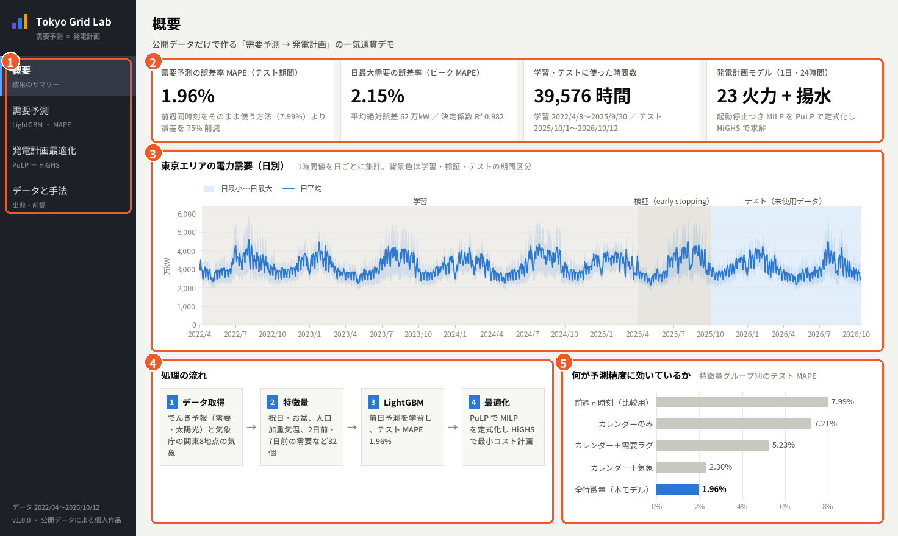

| 番号 | 内容 |
|---|---|
| ① | **サイドバー**：概要／需要予測／発電計画最適化／データと手法 を切り替え |
| ② | **主要指標**：テスト期間の MAPE（1.96%、前週同時刻法 7.99% から誤差 75% 削減）、日最大需要の MAPE と MAE・R²、学習とテストに使った時間数と期間、発電計画モデルの概要 |
| ③ | **東京エリアの電力需要（日別）**：線が日平均、帯が日最小〜日最大。背景色で期間を区別（薄い灰＝学習、濃い灰＝early stopping 用の検証、青＝テスト）。夏と冬に山がある季節パターンが読み取れます |
| ④ | **処理の流れ**：データ取得 → 特徴量 → LightGBM → 最適化 |
| ⑤ | **何が予測精度に効いているか**：特徴量グループを抜き差しして学習し直したテスト MAPE。気象を加えると 7.21% → 2.30% と大きく改善し、需要ラグを加えて 1.96% |

<details>
<summary>マウスを重ねたときの表示（例：2025/7/23 の日平均・日最大・日最小）</summary>

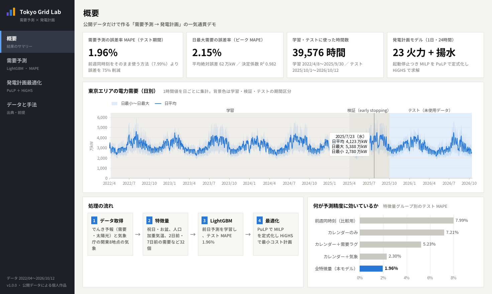

</details>

### 2. 需要予測

LightGBM による前日予測の精度を、いろいろな角度から確認する画面です。右側のパネルで**その場で再学習**もできます。

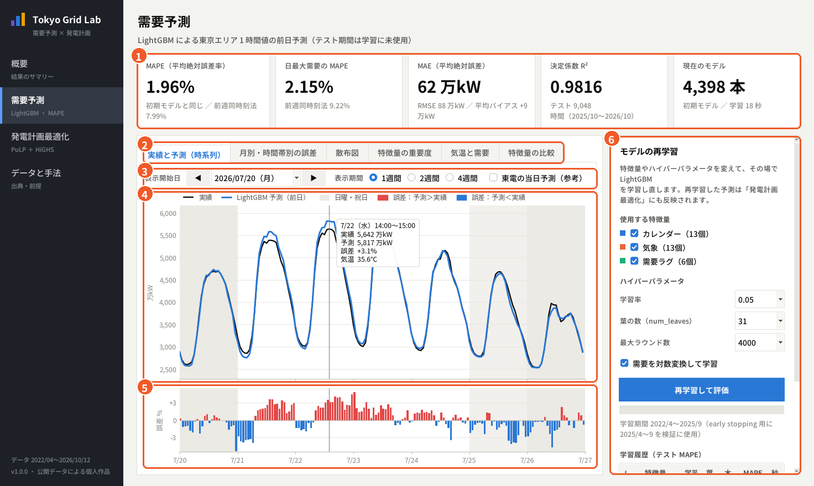

| 番号 | 内容 |
|---|---|
| ① | **指標**：MAPE／日最大需要の MAPE／MAE（RMSE・平均バイアス）／決定係数 R²／現在のモデル（決定木の本数・学習時間）。再学習すると更新され、初期モデルとの差も表示 |
| ② | **グラフの切り替えタブ**（下の 2-1〜2-6） |
| ③ | **表示期間**：開始週（◀ ▶ で前後の週へ）、1 週間・2 週間・4 週間、東電の当日予測（参考）の表示切り替え |
| ④ | **実績（黒）と LightGBM の前日予測（青）**。灰色の背景は土曜（薄）と日曜・祝日（濃）。マウスを重ねると、その時刻の実績・予測・誤差・気温を表示（画像は 2026/7/22 14 時台：実績 5,642 万kW、予測 5,817 万kW、誤差 +3.1%、気温 35.6℃） |
| ⑤ | **1 時間ごとの誤差率**：赤＝予測が実績を上回った時間、青＝下回った時間 |
| ⑥ | **モデルの再学習パネル**（下の 2-7） |

#### 2-1 実績と予測（時系列）

上の画像のタブです。テスト期間の任意の週を表示でき、下部に表示期間だけの MAPE と最大誤差を表示します。気象は実測値を「完全な予報」として使っている（前日予測の想定）旨も画面に明記しています。

#### 2-2 月別・時間帯別の誤差

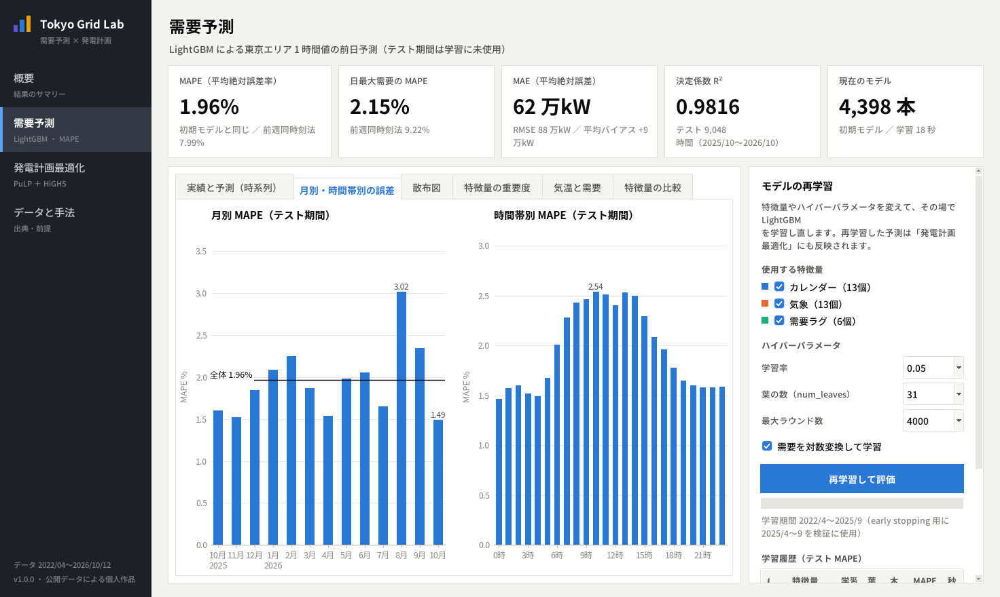

- **月別 MAPE**：最も良いのは 2026 年 10 月（1.49%）、最も悪いのは 2026 年 8 月（3.02%）。8 月は、山の日（8/11）とお盆がつながって休みが前倒しになった 8/10〜12 に需要を過大に予測したのが主因です（8/12 は 1 日平均で +12.3%）。「お盆＝8/13〜16」と固定した特徴量では捉えきれない点で、今後の改善余地です。横線はテスト期間全体の MAPE（1.96%）
- **時間帯別 MAPE**：夜間（0 時台 1.46%）は安定し、気温や日射の影響を受けやすい日中（10 時台 2.54%）に誤差が大きくなります

#### 2-3 散布図

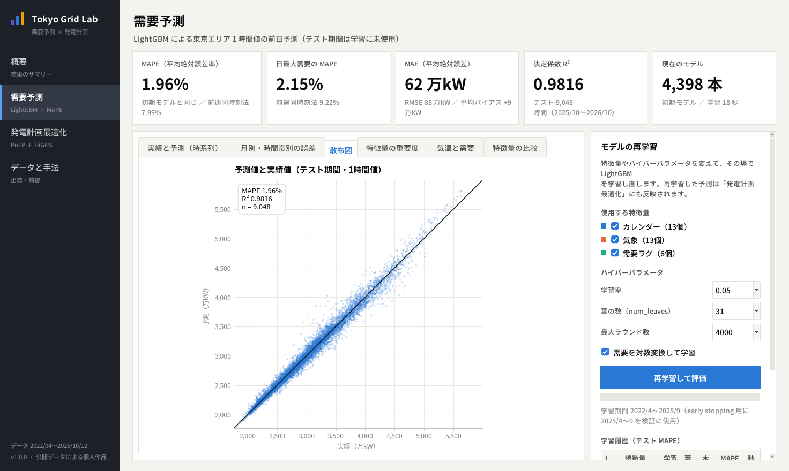

テスト期間 9,048 時間の予測値（縦軸）と実績値（横軸）。点が対角線（予測＝実績）付近に集まっていれば良い予測で、R² は 0.982 です。

#### 2-4 特徴量の重要度

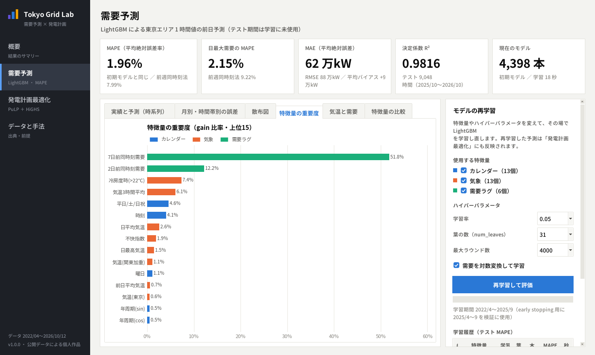

LightGBM の gain（その特徴量で分岐したときの誤差の減り幅）の比率を上位 15 個表示。色はグループ（青＝カレンダー、橙＝気象、緑＝需要ラグ）です。「7 日前の同時刻の需要」（51.8%）と「2 日前の同時刻の需要」（12.2%）で需要の水準をつかみ、冷房度時・気温・日種別などで当日の変化を補正していることが分かります。

#### 2-5 気温と需要

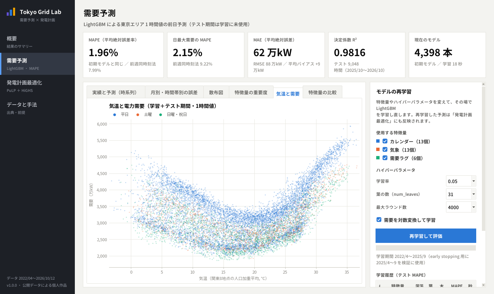

関東 8 地点の人口加重平均気温と需要（1 時間値）の関係。15〜20℃ 付近で最も低く、冷房（25℃ 超）でも暖房（10℃ 未満）でも需要が増える **U 字型**です。色は日種別（青＝平日、橙＝土曜、緑＝日曜・祝日）で、休日は全体に低くなります。この非線形な関係を木モデルが自然に学習できることが LightGBM を選んだ理由の一つです。

#### 2-6 特徴量の比較

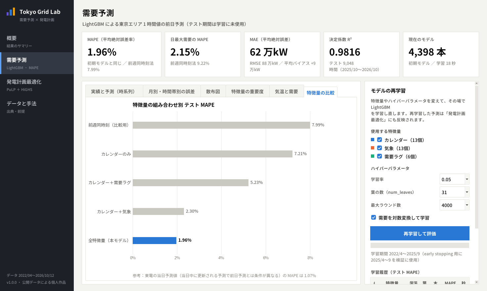

特徴量グループの組み合わせを変えて学習し直したテスト MAPE（アブレーション）。前週同時刻法（7.99%）を基準に、気象を入れることの効果が最も大きいことが分かります。下部には東電の当日予測値の MAPE（1.07%）を参考として表示しています。

#### 2-7 モデルの再学習

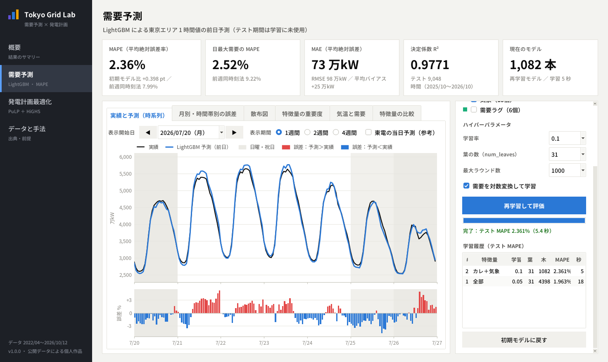

1. **使用する特徴量**（カレンダー 13 個・気象 13 個・需要ラグ 6 個）と**ハイパーパラメータ**（学習率・葉の数・最大ラウンド数・対数変換の有無）を選ぶ
2. **「再学習して評価」** を押すと、① 2025/4〜9 を検証データにした early stopping で木の本数を決め、② その本数×1.1 で学習期間全体を再学習します（進捗バー付き、PC の性能により数秒〜数十秒）
3. 指標・グラフが新しいモデルで更新され、**学習履歴**にテスト MAPE が追加されます。画像は「需要ラグなし・学習率 0.1」で学習した例（MAPE 2.36%、約 6 秒）
4. 再学習した予測は「発電計画最適化」の需要にもそのまま使われます。**「初期モデルに戻す」** で元に戻せます

### 3. 発電計画最適化

予測した需要を満たす 24 時間の発電計画を、PuLP でモデル化し HiGHS で解く画面です。条件を変えるたびにその場で最適化し直します。

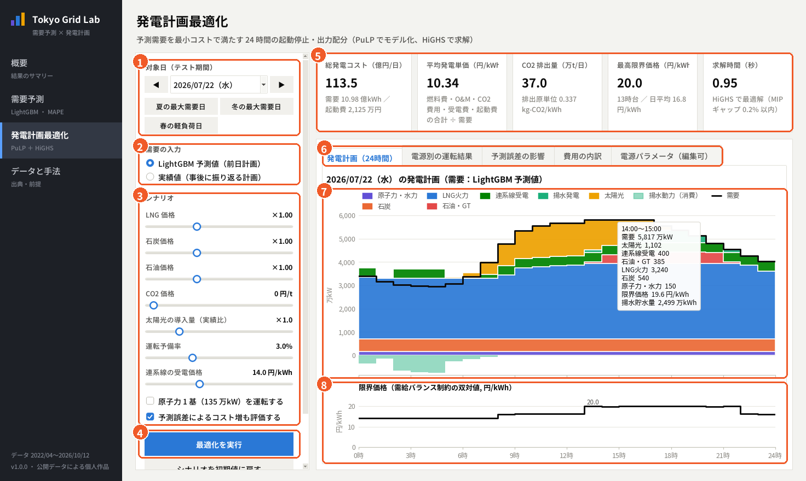

| 番号 | 内容 |
|---|---|
| ① | **対象日**：テスト期間の任意の日（◀ ▶ で前後の日へ）。代表日ボタン：夏の最大需要日（2026/7/22）、冬の最大需要日（2026/2/9）、春の軽負荷日（2026/4/26、昼の太陽光が多く残余需要が最小の日） |
| ② | **需要の入力**：LightGBM 予測値（前日に立てる計画）／実績値（事後に振り返る計画） |
| ③ | **シナリオ**：LNG・石炭・石油の価格（倍率）、CO2 価格、太陽光の導入量（でんき予報の太陽光発電実績に掛ける倍率）、運転予備率、連系線の受電価格、原子力 1 基（135 万kW）の運転、予測誤差によるコスト増の評価の有無。項目にマウスを重ねると前提値の説明が出ます |
| ④ | **最適化を実行**：HiGHS で混合整数計画を解きます（1 秒前後）。対象日を変えたときは自動で再計算 |
| ⑤ | **結果の指標**：総発電コスト（億円/日）、平均発電単価（円/kWh）、CO2 排出量と排出原単位、最高限界価格とその時間帯、求解時間（太陽光の出力制御や供給力不足が出た場合はここに表示） |
| ⑥ | **結果のタブ**（下の 3-1〜3-5） |
| ⑦ | **電源別の出力（1 時間ごとの積み上げ）**：下から 原子力・水力、石炭、LNG 火力、石油・GT、連系線受電、揚水発電、太陽光。黒線が需要、0 より下は揚水動力（ポンプで水をくみ上げるために使う電力）。マウスを重ねると内訳・限界価格・揚水の貯水量を表示（画像は 14 時台：需要 5,817 万kW のうち太陽光 1,102、LNG 3,240、石油・GT 385 など） |
| ⑧ | **限界価格**：需給バランス制約の双対値＝その時間に需要が 1 kWh 増えたときに追加でかかる費用（円/kWh）。夏の午後は石油火力が限界電源になり約 20 円/kWh まで上がります |

#### 3-1 発電計画（24時間）

上の画像のタブです。夏の最大需要日は、安い石炭と高効率の LNG 複合をベースに、需要の山（13〜17 時）では石油火力や緊急設置ガスタービンまで動かし、夜間の安い時間に揚水でくみ上げた水を夕方に発電して高い時間帯を削っています。

#### 3-2 電源別の運転結果

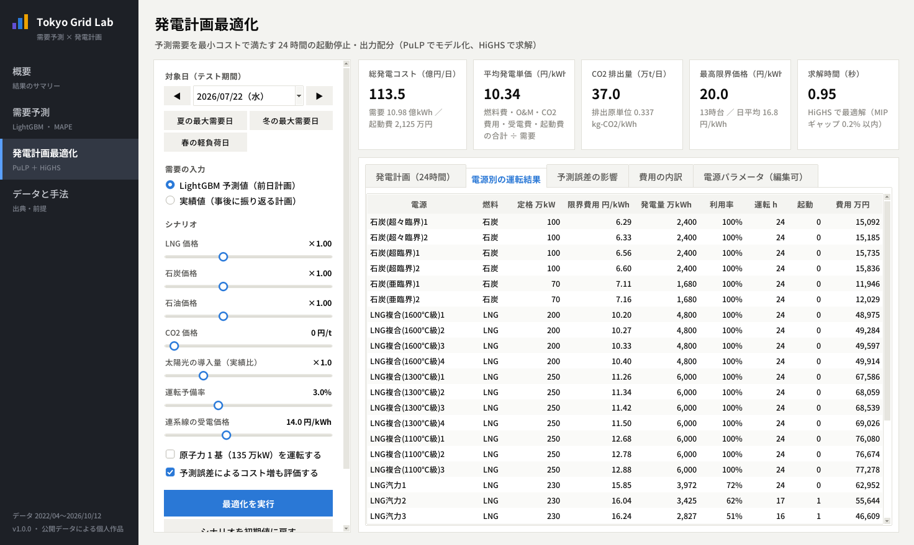

火力 23 ユニットごとの 燃料・定格出力・限界費用・発電量・設備利用率・運転時間・起動回数・費用 の一覧（表形式でも値を確認できるようにしています）。下部に揚水（発電・揚水動力）、連系線受電、太陽光（利用・出力制御）、一般水力の行があります。

#### 3-3 予測誤差の影響

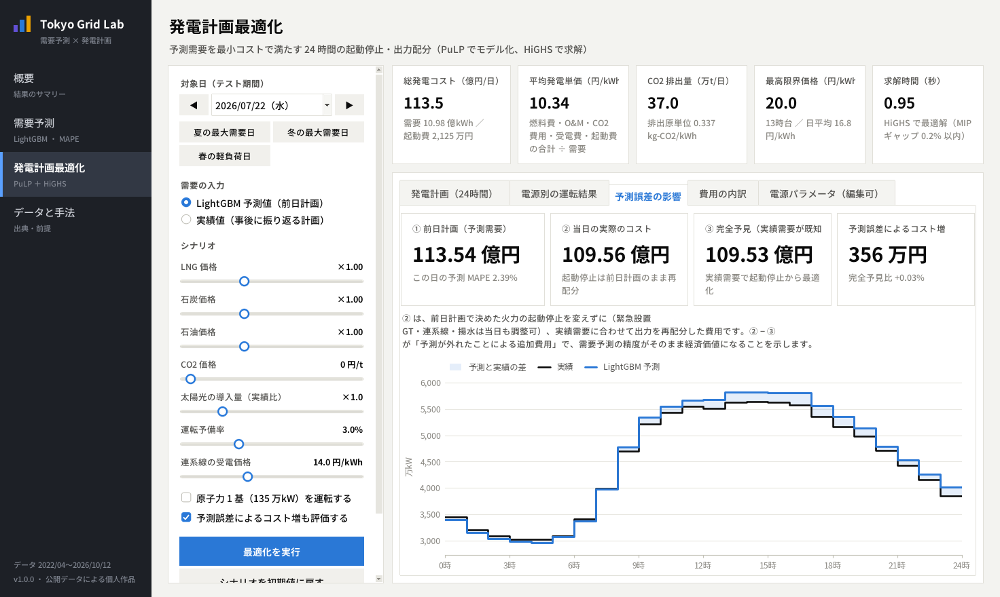

需要予測の精度が、どれだけ発電コストに効くかを評価するタブです。

- ① **前日計画**：LightGBM の予測需要で起動停止と出力を決めた計画の費用
- ② **当日の実際のコスト**：①で決めた火力の起動停止はそのまま（緊急設置 GT・連系線・揚水は当日も調整可）で、実績需要に合わせて出力を配分し直した費用
- ③ **完全予見**：実績需要を事前に知っていた場合の最適費用
- **予測誤差によるコスト増 ＝ ② − ③**。2026/7/22 は MAPE 2.39% で 356 万円/日（+0.03%）。下のグラフでその日の予測と実績のずれを確認できます

#### 3-4 費用の内訳

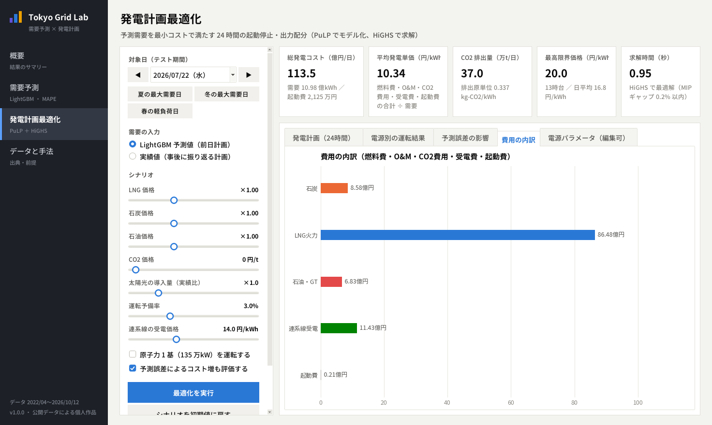

区分ごとの費用（燃料費・運転維持費・CO2 費用・受電費）と起動費。LNG 火力が全体の大半を占めることが分かります。

#### 3-5 電源パラメータ（編集可）

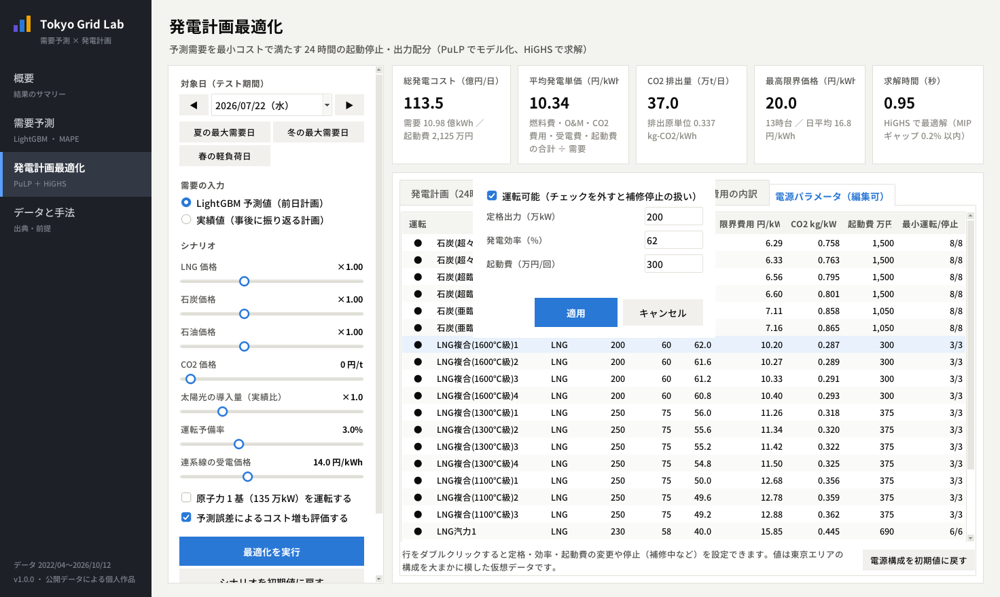

23 ユニットの 定格出力・最低出力・効率・限界費用・CO2 排出原単位・起動費・最小運転/停止時間 の一覧です。行をダブルクリックすると、**運転可能（チェックを外すと補修停止扱い）・定格出力・発電効率・起動費** を変更できます。変更後に「最適化を実行」すると反映され、「電源構成を初期値に戻す」で元に戻ります。

#### 3-6 シナリオの例：春の軽負荷日に太陽光 2.5 倍・CO2 1 万円/t

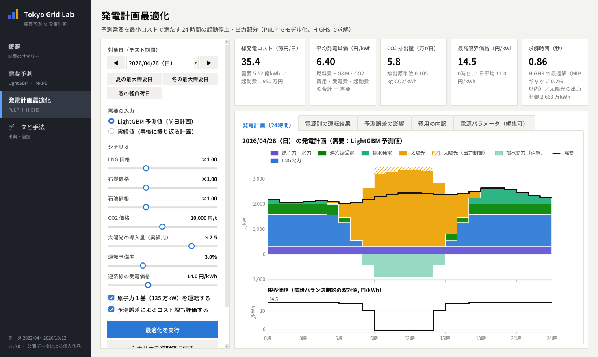

2026/4/26（日）に、太陽光の導入量 2.5 倍・CO2 価格 10,000 円/t・原子力 1 基運転 を設定した例です。

- CO2 費用で石炭が LNG より高くなり、石炭火力が止まります
- 昼は太陽光が需要を上回るため、**揚水でくみ上げ（0 より下の帯）**、それでも余る分は**出力制御**（斜線、2,663 万kWh）
- 昼の限界価格はほぼ 0 円/kWh まで下がり、夕方以降は揚水発電と LNG で需要をまかないます
- 総コスト 35.4 億円/日、平均 6.40 円/kWh、CO2 5.8 万 t（排出原単位 0.105 kg/kWh）

### 4. データと手法

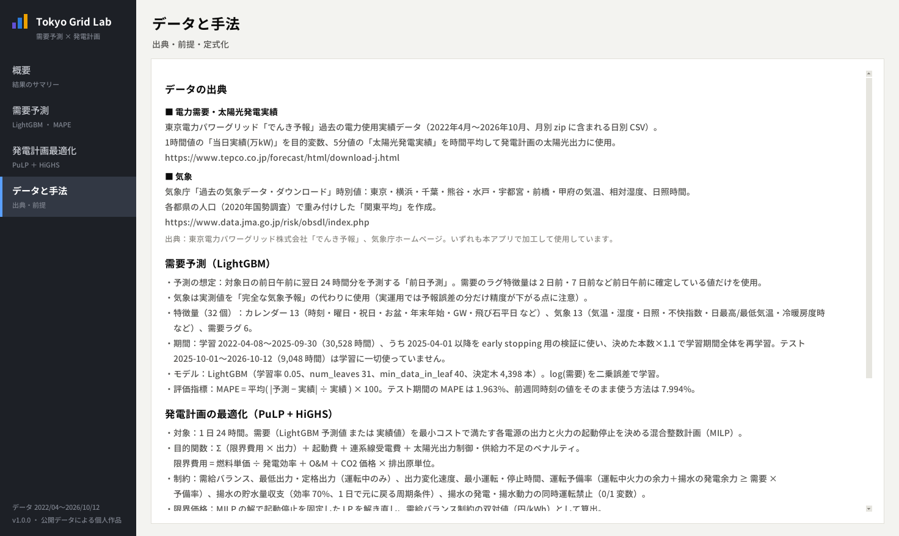

データの出典、需要予測と最適化の前提・定式化、使用ソフトウェアをアプリ内で確認できるページです（内容は下の「データ」「手法」と同じ）。

---

## データ

| データ | 出典 | 使い方 |
|---|---|---|
| 電力需要・太陽光 | 東京電力パワーグリッド「[でんき予報](https://www.tepco.co.jp/forecast/html/download-j.html)」過去の電力使用実績データ（2022/4〜2026/10） | 1 時間値の当日実績（万kW）を目的変数に。5 分値の太陽光発電実績を時間平均して発電計画の太陽光出力に使用 |
| 気象 | 気象庁「[過去の気象データ・ダウンロード](https://www.data.jma.go.jp/risk/obsdl/index.php)」時別値 | 東京・横浜・千葉・熊谷・水戸・宇都宮・前橋・甲府の気温・相対湿度・日照時間。都県人口（2020 年国勢調査）で重み付けした「関東平均」も作成 |

- このリポジトリには**整形済みのデータ**（`data/processed/hourly_dataset.csv`：1 時間値 39,744 行、`app/assets/app_data.npz`：アプリ用）だけを置いています
- 公開元の**原データ（zip）は含めていません**。`python tools/download_data.py` で `data_raw/` に取得できます（でんき予報の月別 zip と、気象庁の月別 CSV をまとめて保存）

出典：東京電力パワーグリッド株式会社「でんき予報」、気象庁ホームページ（いずれも加工して作成）。

## 手法

### 需要予測（LightGBM）

- **前日予測を想定**：対象日の前日午前に翌日 24 時間分を予測。需要のラグ特徴量は前日午前に確定している 2 日前・7 日前の値だけを使用
- **特徴量 32 個**：カレンダー 13（時刻・曜日・祝日・お盆・年末年始・GW・飛び石平日 など）、気象 13（気温・湿度・日照・不快指数・日最高/最低気温・冷暖房度時 など）、需要ラグ 6
- 気象は実測値を「完全な気象予報」の代わりに使用（実運用では気象予報の誤差の分だけ精度が下がります）
- **学習**：2022/4/8〜2025/9/30。うち 2025/4 以降を early stopping 用の検証に使い、決めた本数×1.1 で学習期間全体を再学習。log(需要) を二乗誤差で学習（相対誤差に近い基準）
- **評価**：MAPE = 平均( |予測 − 実績| ÷ 実績 ) × 100

### 発電計画の最適化（PuLP + HiGHS）

1 日 24 時間の混合整数計画（MILP）。PuLP でモデルを書き、HiGHS（highspy）で解きます。

- **目的関数**：Σ（限界費用 × 出力）＋ 起動費 ＋ 連系線受電費 ＋ 太陽光出力制御・供給力不足のペナルティ
  - 限界費用 ＝ 燃料単価 ÷ 発電効率 ＋ 運転維持費 ＋ CO2 価格 × 排出原単位
- **制約**：需給バランス／最低出力・定格出力（運転中のみ、0-1 変数）／出力変化速度／最小運転時間・最小停止時間／運転予備率（運転中火力の余力＋揚水の発電余力 ≥ 需要 × 予備率）／揚水の貯水量収支（総合効率 70%、1 日で元に戻る周期条件）と発電・揚水の同時運転禁止
- **限界価格**：MILP の解で起動停止を固定した LP を解き直し、需給バランス制約の双対値として算出
- **電源構成**：石炭 6・LNG 複合 11・LNG 汽力 3・石油 2・緊急設置 GT・揚水・一般水力・連系線。燃料価格は LNG 12 ドル/MMBtu、一般炭 110 ドル/t、原油 75 ドル/バレル、150 円/ドル程度を想定した概数で、東京エリアを大まかに模した**仮想データ**です（実在の発電所の値ではありません）

## フォルダ構成

```
app/                    アプリ（exe と同じソースコード）
  tepco_app.py          エントリーポイント（Tkinter）
  core/forecast.py      LightGBM の学習・評価（アプリ内の再学習もこれを使用）
  core/dispatch.py      PuLP + HiGHS の発電計画モデル
  core/datastore.py     同梱データの読み込み
  ui/                   各画面・グラフ・共通部品
  assets/               アプリ同梱データ（予測結果・指標・フォント・アイコン）
src/
  prepare_data.py       原データ → 1 時間値データセット
  features.py           特徴量の作成
  train_model.py        LightGBM の学習・評価 → app/assets/ と models/ に出力
tools/
  download_data.py      公開データのダウンロード（data_raw/ に保存）
  make_assets.py        フォントのサブセット化・アイコン・スプラッシュ画像の生成
build/                  exe のビルド設定（PyInstaller の spec、ビルドスクリプト）
data/processed/         整形済みデータとテスト期間の予測結果
models/lgbm_model.txt   学習済み LightGBM モデル
docs/images/            README 用の画面イメージ
```

## 開発環境での実行・再現

Python 3.12（64bit）で動作を確認しています。

```bat
python -m venv .venv
.venv\Scripts\activate
pip install -r requirements.txt

python app\tepco_app.py             :: アプリを起動（同梱データだけで動きます）

python tools\download_data.py       :: 公開データを data_raw\ に取得
python src\prepare_data.py          :: 1 時間値データセットを作成
python src\train_model.py           :: LightGBM を学習・評価（app\assets\ を更新）
build\build_exe.bat                 :: exe を作成（dist\TokyoGridLab.exe）
```

配布している exe は、Linux 上の Wine で Windows 版 Python 3.12 と PyInstaller を使ってビルドしました（`build/build_with_wine.sh`）。LightGBM と HiGHS が使う MSVC ランタイムを同梱しているので、Visual C++ 再頒布パッケージが入っていない PC でも動きます。

## 注意事項

- 気象は実測値を「完全な予報」として使っています。実際の前日予測では気象予報の誤差が加わります
- 発電計画の電源構成・燃料価格・効率などは手法を示すための仮定値で、実在の発電所・事業者のデータではありません
- 本作品は公開データを用いた個人のポートフォリオであり、東京電力グループ・気象庁とは関係ありません

### 使用ソフトウェア

Python 3.12、LightGBM 4.7（MIT）、PuLP 3.3（BSD）、HiGHS 1.13（MIT）、NumPy、SciPy、matplotlib、Pillow、Tkinter、PyInstaller。
フォントは Noto Sans CJK JP（SIL Open Font License 1.1）の使用文字サブセットを同梱しています（`app/assets/fonts/`）。
